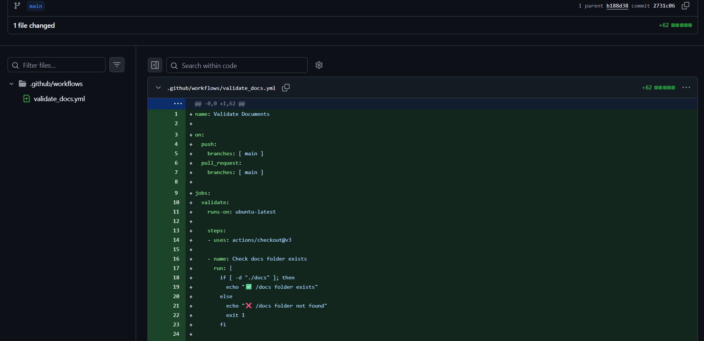
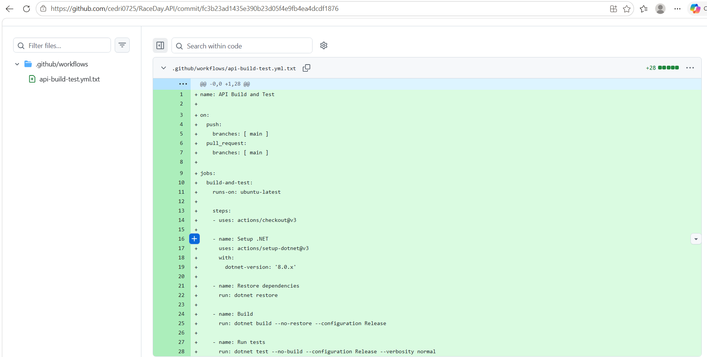

# RaceDay - Event Management System

## Overview
RaceDay is a full-stack web-based event management system designed for the South African road running, walking, and cycling community.

This repository contains the complete project across all three parts of the PROG6212 Portfolio of Evidence:

- **Part 1**: System Planning and Database (ERD, API endpoint plan, SQL script)
- **Part 2**: RESTful API Development (ASP.NET Core Web API, EF Core, Unit Tests, CI/CD)
- **Part 3**: MVC Web Application (Coming soon)

## User Roles
1. **Organiser** - Creates and manages events, categories, and participant results
2. **Participant** - Browses events, enrols in events, tracks personal results

## Project Structure

RaceDay/
│
├── .github/
│   └── workflows/
│       ├── validate-docs.yml              # Part 1 - Document validation workflow
│       └── api-build-test.yml             # Part 2 - API build and test workflow
│
├── docs/                                   # PART 1 - PLANNING AND DATABASE
│   ├── ERD_PROG.jpg
│   ├── endpoint-plan.md
│   ├── RaceDay_Database.sql
│   └── Database_Results.png
│
├── RaceDay.API/                            # PART 2 - RESTFUL API PROJECT
│   ├── Controllers/
│   ├── Data/
│   ├── DTOs/
│   ├── Middleware/
│   ├── Migrations/
│   ├── Models/
│   ├── Properties/
│   ├── Services/
│   ├── appsettings.json
│   ├── appsettings.Development.json
│   ├── Program.cs
│   ├── RaceDay.API.csproj
│   └── RaceDay.API.http
│
├── RaceDay.API.Tests/                      # PART 2 - UNIT TESTS
│   └── RaceDay.API.Tests.csproj
│
├── .gitignore
├── readme.md
├── workflow.png                            # Part 1 green build screenshot
├── ci-cd-success.png                       # Part 2 green build screenshot
└── Screenshot_1.png ... Screenshot_5.png   # Part 1 screenshots

## CI/CD Status

### Part 1 - Document Validation

## YouTube Video
[Watch the walkthrough](https://youtu.be/hBsQXPo8uqw)

### Part 2 - API Build and Test

## YouTube Video
[Watch the walkthrough](https://youtu.be/hBsQXPo8uqw)

## How to Run the SQL Script
1. Open SQL Server Management Studio
2. Connect to your SQL Server instance
3. Open `docs/RaceDay_Database.sql`
4. Click Execute (F5)

---

## Part 2 - RESTful API

### Technology Stack

| Technology | Purpose |
|------------|---------|
| ASP.NET Core 8.0 Web API | RESTful API framework |
| C# | Programming language |
| Entity Framework Core 8.0 | ORM with Code-First approach |
| SQL Server | Database |
| JWT (JSON Web Tokens) | Authentication and session management |
| BCrypt.Net | Password hashing |
| Swagger (Swashbuckle) | API documentation and testing UI |
| xUnit | Unit testing framework |
| GitHub Actions | CI/CD pipeline |

### Setup Instructions

#### Prerequisites

- .NET 8.0 SDK
- SQL Server (Express or Developer edition)
- Visual Studio 2022 (Community edition) or Visual Studio Code with C# Dev Kit
- SQL Server Management Studio (SSMS)

